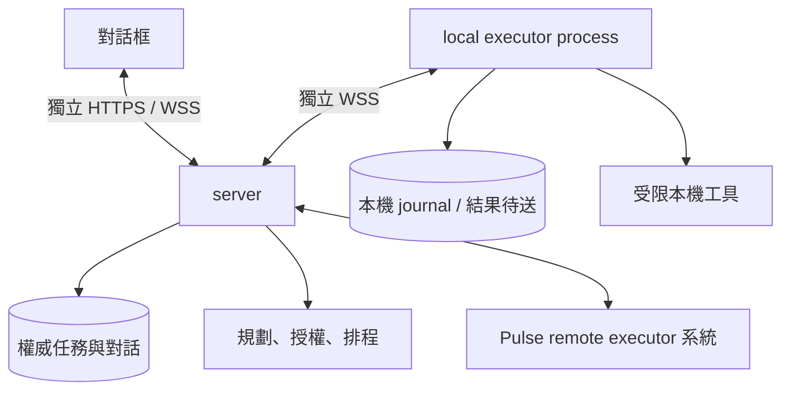

# v0.1 架構與 Rust 技術決策

日期：2026-10-30，Asia/Taipei。研究 issue：[#1](https://github.com/faberline/pulse/issues/1)。

本文定義後續實作。本文沒有宣稱程式、部署或完整產品已通過驗收。行為細節見 [契約](contracts.md)，證據與缺口見 [驗收](acceptance.md)。

## 1. 已確認的產品決策

| ID | 決策 | 來源 |
|---|---|---|
| U01 | 單人使用，同一對話可討論多個任務，各任務有獨立 context | 原 v0.1 與本次使用者確認 |
| U02 | v0.1 先完成架構規格，產品實作從 v0.2 開始 | 使用者選擇「先完成架構規格」 |
| U03 | server、agent runtime 與地端執行器採 Rust；桌面 UI 依 U12 採 Swift | 使用者要求 Rust，後續確認 Swift 介面 |
| U04 | 模型採雲端 Anthropic API | 使用者選擇雲端 API 與 Anthropic |
| U05 | 首個只讀分析範圍是 Pulse 本身 | 使用者選擇「Pulse 本身」 |
| U06 | Pulse 必要文件與程式可按需上雲，排除憑證及私密設定 | 使用者選擇「按需傳送文件與程式」 |
| U07 | 模型 API 每日 US$1，每任務 US$0.25 | 使用者選擇的預算 |
| U08 | 完成任務保留 90 天、除錯紀錄 7 天、備份 30 天，可提早刪除 | 使用者選擇「限期保存」 |
| U09 | 三個元件為 server、對話框、executor | 使用者於 2026-10-31 修正 |
| U10 | executor 分為 remote 系統與 local process；remote 不綁定 VM | 使用者於 2026-10-31 修正 |
| U11 | remote 由 Pulse 自行實作；只在能減少程式時重用 core，不接 AW | 使用者於 2026-10-31 修正；取代先前 AW 整合方向 |
| U12 | 桌面 UI 改用 SwiftUI；server 與 executor 保留 Rust | 使用者於 2026-10-31 確認 |
| U13 | Swift 只負責介面；核心採 Rust，讓不同介面共用同一套命令、狀態與事件 | 使用者於 2026-11-02 再確認 |

一台 macOS Apple Silicon 裝置、一個地端 worker、雲端最多兩個執行中任務，是本版實作預設。這些數值可經新決策修改，但不能由模型自行調高。

## 2. 首個端到端情境

1. 人類在桌面要求分析 Pulse 的架構或程式。雲端保存來源事件，再確認收件。
2. 任務 A 只讀取必要的 Pulse 內容，形成分析與草稿。
3. 人類交付需要本機內容的任務 B。裝置離線時，B 進入等待裝置狀態。
4. 人類回到 A，補充或取代決策。A 使用有效決策，B 不受誤改。
5. 查詢進度不建立新任務。取消指涉不清時先澄清。
6. 雲端可用既有且仍有效的雲端資料繼續 A。若 A 也需要未取得的本機資料，A 同樣等待。
7. 重連先處理未確認結果與未知操作，再恢復可安全繼續的工作。

離線桌面只能顯示快取與最後同步時間。雲端仍可接收經認證的 HTTP 請求，但本版不另建手機或瀏覽器入口。測試客戶端可驗證此能力，不能把它當作另一套已交付 UI。

## 3. 邏輯與程序邊界

| 模組 | 責任 | 不可跨越的邊界 |
|---|---|---|
| ingress / coordinator | 認證、持久收件、對話投影與任務關聯 | 收件不等於執行成功 |
| domain / store | 任務、決策、批准、版本與交易 | 模型記憶不取代 DB |
| scheduler / outbox | queue、計時、優先序、重試、可靠通知 | 不需要 LLM |
| planner / provider | 組裝 context、模型呼叫、工具提議 | 不直接執行未核對操作 |
| policy | 核對來源、scope、revision、批准與預算 | 模型與工具內容不可修改 policy |
| local executor | 獨立 process、outbound 連線、journal、結果補送、本機工具 | 不承載人類對話，不接受任意遠端 shell |
| remote executor | Pulse 自己的派工、執行、checkpoint 與恢復 | 不綁定 VM 或 PID，不接 AW；工具結果不能授權新操作 |
| desktop / SwiftUI | 同一對話、rich content、狀態、批准與取消 | 顯示內容不能形成授權 |

雲端先採單一服務。這些模組不是七個微服務，也不要求一個任務配一個常駐 process。等待時保存進度並釋放工作名額。

SwiftUI 透過自己的 Rust chat 傳輸程序連 server。兩者使用私有、有界 JSON Lines。local executor 獨立連 server。兩者有各自的身分與私有 journal。對話框不啟動、代理或終止 executor。關閉對話框後，executor 仍可回傳結果。server 保存結果，對話框重開後再同步。

SwiftUI 是可替換的顯示與輸入層。任務關聯、記憶、批准核對、排程、費用、執行與恢復均由 Rust 擁有。
介面可以先檢查輸入格式或停用無效按鈕；Rust 仍必須重查全部規則，不能相信畫面已查過。
新增 CLI、網頁或其他原生介面時，共用 Rust 的命令與狀態契約，不複製任務邏輯或另建權威資料庫。
目前 `pulse-chat` 的 JSON Lines 入口已不依賴 Swift。命令與回覆定義在 `crates/pulse-link/src/protocol.rs` 的 `NativeCommand`／`NativeState`；名稱是歷史名稱，不限制介面語言。
這個入口使用 chat 身分，不能當作 executor 身分或新增工具授權。

2026-11-02 邊界檢查：目前 `PulseComputerCore`／`PulseComputerHelper` 仍有 Swift 實作的 macOS 擷取與操作橋接；`ComputerWindowPicker` 也直接讀取系統視窗清單。
依 U13，這些非顯示功能須移入 Rust local executor 的 macOS adapter，並由共用的本機協定供介面使用。
這項遷移尚未完成。不能把目前 Swift helper 當作「Swift 只做 UI」已通過的證據；原有目標限縮、原圖核對、一次性批准、程序中止與未知結果限制仍須保留。

remote executor 是 Pulse 自己的執行系統。沿用 `pulse-core::Store` 的持久任務、run token、checkpoint、重試與取消。先不增加另一套工作 DB、外部系統介面或服務。faberline/core 只在可減少重複程式時使用。模型與工具執行迴圈仍是 v0.4 工作，不能把現有狀態核心當作已完成的模型閉環。

## 4. 技術選型與替代方案

下列版本是 2026-10-30 官方文件所示的研究基準，不是已編譯的相容性證明。v0.2 須固定 Rust toolchain 與 Cargo.lock，並記錄實際 resolved versions。

| 決策 | 選擇與理由 | 已比較的替代方案 |
|---|---|---|
| A01 非同步服務 | Tokio + Axum 0.8 系列。HTTP、WSS 與取消可放在同一 Rust 執行環境 | Actix 同樣可用；先選 Axum 以統一 Tokio 生態 |
| A02 雲端 DB | SQLx 0.9 系列 + SQLite。單機、交易、migration 與簡單 queue 足以處理個人工作量 | PostgreSQL 增加服務與維護需求；多主機需求出現後再評估 |
| A03 桌面 UI | SwiftUI + AppKit 原生文字與檔案選取元件；Rust 保留可靠 chat 傳輸 | 取代 iced，不維護兩套介面，不新增 JS 前端 |
| A04 傳輸 | HTTP 收件/查詢 + WSS 雙向裝置流。HTTP 與 socket 都套用相同持久收件契約 | SSE/long polling 可行，但裝置仍需要反向送結果；本版只實作 WSS |
| A05 元件連線 | 對話框與 local process 各自使用 HTTPS/WSS 連 server | 取代原 UI/helper 私有 stdio 設計；不增加本機 TCP 入口 |
| A06 模型 | reqwest + Serde 直接連 Anthropic Messages API，使用 `claude-sonnet-5-5` | 地端 CLI 依賴裝置在線；本版不採雙 provider 或自動 fallback |
| A07 執行系統 | Pulse 自行實作；沿用現有任務核心，按需重用 faberline/core | 取代先前 AW 整合方向；不增加外部 runtime 或多餘的服務 |
| A08 server 部署 | 單一持久服務及 TLS 入口；SQLite 需要可靠本機磁碟 | 實際主機仍未建立。此選型不定義 remote executor 的形態 |
| A09 觀測 | tracing 結構化事件、健康查詢與任務證據關聯鍵 | 不先架獨立 trace 平台；必要時再出口至 OTel |

部署契約不綁雲端廠商。實際主機、網域與帳單需在部署 issue 有明確設定後才建立。選型不授權採購或公開服務。

原 v0.1 研究環境為 Darwin arm64、rustc/cargo 1.96.1。當時的未驗證狀態是歷史紀錄；本次 SwiftUI 與 Rust 實作證據見 [Swift 桌面](swift-desktop.md)。

## 5. 資料、排隊與恢復

雲端 SQLite 保存所有權威任務資料。來源事件、任務投影、執行/checkpoint、操作收據、預算與 outbox 使用明確表及交易，並不要求多個 DB。文字成果先存 DB；本機大檔僅保留授權的參照，不自動上傳整個 repo。

雲端與地端 SQLite 均採 WAL、`synchronous=FULL`、foreign keys 與有界 busy timeout。雲端 DB 寫入透過單一 writer 排隊，交易內不等待模型、網路或工具。讀取不可開啟無限長交易。磁碟滿或 commit 失敗時不回覆 durable ACK。

SQLite 必須使用已修正 WAL-reset 問題的版本。基準為 3.51.3 或更新版本；實作 gate 核對 bundled/runtime 版本與官方修正資訊。不得只依賴 SQLx 版本推論 SQLite 安全版本。

備份採 SQLite Online Backup API 或經驗證的一致性快照。不可只複製開啟中的 `.db` 檔而忽略 WAL。migration 前備份，還原到獨立目錄並驗完整性後才切換；相容性不明則停止，不能自動降版開庫。

地端 DB 只保存 dedupe journal、必要快取、operation receipts 與未確認 outbox。重啟後先核對雲端狀態，不自行產生新的批准、任務真相或排程分支。

## 6. 認證與最小權限

單一 owner 由操作者在部署時建立。不增加公開註冊或多使用者登入。操作者從受保護的管理程序建立單次配對碼，十分鐘到期。配對碼不寫入普通 logs。

對話框與 local executor 分開配對。各角色各允許一個有效身分，並有自己的可撤銷 opaque token。server 由配對碼決定角色；executor 身分不能送出人類控制事件。token 至少含 32 bytes 的密碼安全隨機資料。地端 token 留在 macOS Keychain，伺服器保存驗證用雜湊。所有遠端連線走 HTTPS/WSS。輪替是明確的管理操作；舊 token 撤銷後不可建立新連線、派送或續租。身份只代表裝置，不代表已批准操作。

`ANTHROPIC_API_KEY` 由雲端受保護的 secret 檔或服務環境注入。不得進入 repo、桌面訊息、task payload、模型 context 或 trace。不要複製本機 CLI 的登入資料來代替 API 認證。

第一版 repo 工具只有列檔、讀文字、Git status 與 diff。所有路徑限制在 Pulse，不能讀 `.git` 原始檔、私密設定或跟隨 symlink 越界。Git 只經固定子命令讀取，禁止 hooks、外部 diff/textconv 與額外網路存取。

任意命令、repo 寫入、電腦控制、對外發送、merge 與部署均不在首批工具清單。v0.5 先用模擬副作用驗證寫入契約；真實 adapter 須另有明確授權。

## 7. 五項優先設計決策

| ID | 決定 | 契約位置 |
|---|---|---|
| D1 對話關聯 | 明確 task ID/回覆優先；查詢不開新工作；會影響執行的歧義先澄清 | K02、K03 |
| D2 context 同步 | 每次動作核對 revision；只使用有效決策與必要證據；不足則等待 | K04、K09 |
| D3 互動隔離 | 對話框與 local executor 獨立存活及連線；限制執行量 | K06、K12 |
| D4 離線呈現 | 快取附同步時間，未 commit 輸入維持 pending；重連先補送與核對 | K06、K07 |
| D5 首個閉環 | Pulse 只讀分析 A，加上等待裝置 B；不用真實寫入證明可靠性 | K05、K08、K09 |

## 8. 官方依據與未證實項

下列來源於 2026-10-30 查閱。它們支持介面或產品限制，不代表本案已通過實測。

| 來源 | 本案用途 |
|---|---|
| [Axum WebSocket](https://docs.rs/axum/latest/axum/extract/ws/) | HTTP 升級與雙向流介面 |
| [SQLx SQLite options](https://docs.rs/sqlx/latest/sqlx/sqlite/struct.SqliteConnectOptions.html) | 明確設定 WAL、同步及連線選項 |
| [SQLite WAL](https://www.sqlite.org/wal.html) | 同機限制、單 writer 與 WAL-reset 修正 |
| [SQLite backup](https://www.sqlite.org/backup.html) | 一致性線上備份 |
| [SwiftUI / AppKit bridge](https://developer.apple.com/documentation/SwiftUI/NSViewRepresentable) | Swift 原生介面與文字編輯；U12 取代原 iced 選型 |
| [Tauri architecture](https://v2.tauri.app/concept/architecture/) | 比較 Rust core 與 WebView 路線 |
| [Anthropic Messages](https://platform.claude.com/docs/en/api/messages/create) | 模型、工具提議及 usage 介面 |
| [Anthropic streaming](https://platform.claude.com/docs/en/build-with-claude/streaming) | 增量訊息與中斷處理 |
| [Sonnet 5.5](https://platform.claude.com/docs/en/models/sonnet-5-5/overview) | 首個模型 ID 及公開費率 |
| [Model versioning](https://platform.claude.com/docs/en/about-claude/models/model-ids-and-versions) | model ID 與快照語意；服務行為仍需回歸測試 |
| [Token counting](https://platform.claude.com/docs/en/build-with-claude/token-counting) | 計數是估算，不能冒充最終帳單 |

尚未證實：依賴整合編譯、中文輸入與 rich UI、實機斷線恢復、模型帳號可用性、真實 API usage、完整 Pulse remote/provider 閉環、部署及效能。這些項目的 gate 見驗收文件。
