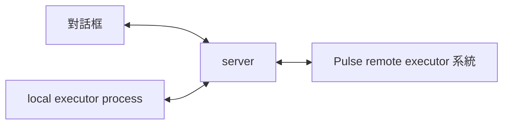

# v0.3 桌面與地端連線候選

本階段對應 issues #9–#12。分支為 `codex/v0.3-desktop-device`。它堆疊在 v0.2 的 `d08ccddefebf2e3d9870dab7d42f106b7b1d1f47` 上。兩階段都仍需獨立接受。這不是完整 MVP 接受紀錄。

目前介面已改用 SwiftUI。建置與本次實測見 [Swift 桌面](swift-desktop.md)。下方舊候選的 iced／coverage 紀錄只保留作歷史證據。

## 三個元件

使用者於 2026-10-31 確認以下分工。它取代原本由桌面啟動 local executor 的設計。

| 元件 | 責任 | 目前實作 |
|---|---|---|
| server | 保存對話、任務、授權、派工與結果 | `pulse-server` |
| 對話框 | 一個輸入框、對話紀錄與進度 | SwiftUI `pulse-desktop`，透過專屬 Rust `pulse-chat` 連 server |
| executor / local | 在使用者電腦執行獲准操作 | 獨立 `pulse-executor` process，直接連 server |
| executor / remote | Pulse 自己的執行系統 | 沿用 `pulse-core` 的任務、派工、checkpoint 與恢復；只讀模型／工具迴圈見 v0.4 候選 |



remote 是 Pulse 自己的系統，不是特定 VM，也不接 AW。沿用現有 `pulse-core` 的持久任務、run token、checkpoint 與恢復。先不加外部系統介面、另一套 queue 或 DB。server 仍負責核對權限、任務修訂、結果與費用。只讀模型與工具迴圈已有 [v0.4 候選](v0.4-remote.md)，完整多任務接受仍未完成。

SwiftUI 對話框沒有 repo 設定，也沒有執行工具的 worker。它啟動自己的 Rust chat 傳輸程序，沿用 journal 與 Keychain；它不啟動 local executor。它不啟動或終止 executor。關閉對話框後，local process 繼續連線。結果由 server 保存，對話框重開後再同步。

對話框與 local 各有自己的 Keychain 身分與私有 journal。server 從配對碼綁定角色。local 只能送工具結果，不能送人類指令。對話框不能偽造工具結果。各角色目前各允許一個有效身分。

## 資料與升級

migration 1 保持原樣。migration 2 保存裝置傳輸與操作。migration 3 增加角色及本機停止狀態。舊版混合身分與未用配對碼會失效，須重新分開配對。任務、對話與結果紀錄保留。

升級前須建立一致性 DB 備份。不要只複製運行中的主 DB 檔。先停止舊版程序，或用 SQLite backup API 建立快照。舊 local executor journal 保留作核對；請為 chat 與 local 分別建立新私有目錄。舊版尚未確認的輸入與操作須先核對，不會自動改綁或宣稱完成。

server、chat 與 local journal 各有獨占檔案鎖。DB 為 0600。私有目錄為 0700。拒絕 symlink 與不安全權限。密鑰只存 Keychain，不退回明文檔案。

## 本機試用

需要 macOS、Rust 1.96.1 與可用的登入 Keychain。從 Pulse 根目錄執行：

```sh
sh scripts/build-macos-app.sh --debug
pulse_private_dir=$(mktemp -d)
chmod 700 "$pulse_private_dir"
target/debug/pulse-server pair-chat "$pulse_private_dir/cloud.db" "$pulse_private_dir/chat-code"
target/debug/pulse-server pair-local "$pulse_private_dir/cloud.db" "$pulse_private_dir/local-code"
target/debug/pulse-server serve "$pulse_private_dir/cloud.db" 8721
```

保留 server。在另一個終端機啟動 local process。以下參數須使用剛才 private directory 的完整路徑。

```sh
target/debug/Pulse.app/Contents/MacOS/pulse-executor \
  --server http://127.0.0.1:8721 \
  --repo /Users/chrischeng/faberlines/pulse \
  --data-dir /FULL/PATH/TO/PRIVATE/DIRECTORY/local \
  --pair-code-file /FULL/PATH/TO/PRIVATE/DIRECTORY/local-code \
  --dev-loopback
```

配對成功後，重新啟動時移除 `--pair-code-file`。身分會從 Keychain 讀回。local 不讀 stdin，也不因對話框關閉而退出。終端機的 Ctrl+C 可結束該 process。

開啟對話框：

```sh
open -n target/debug/Pulse.app --args \
  --server http://127.0.0.1:8721 \
  --data-dir /FULL/PATH/TO/PRIVATE/DIRECTORY/chat \
  --dev-loopback
```

在「設定」輸入 `chat-code` 的內容。兩個配對碼各限對應角色使用一次，十分鐘後失效。不要把配對碼或密鑰貼到 issue、PR 或 log。成功後刪除配對碼檔案。

也可直接從設定頁連線。只需伺服器位址。私有資料目錄與 HTTP 測試開關收在「進階設定」。工作資料夾由 local 啟動參數選定。

主畫面只有一個可換行的輸入框。Enter 換行；Command+Enter 或「傳送」送出。啟動時焦點放在對話框。對話框內的 Command+N 聚焦對話、Command+L 開啟設定、Command+I 選取圖片。

訊息在確認保存後才清空。確認等待期間的新編輯會保留。重新連線只向同一 server 與 journal 重送原訊息 ID 與 task ID。切換來源時不自動重送。多行中文與 code 原樣保存。

任務資訊預設收起。可開啟「進度」，選取任務，再展開「更多操作」讀取專案說明或 Git 狀態。server 會派給獨立 local executor。local 不在線或已停止時，不會派給對話框。一般訊息尚不會由模型解析成工具命令。

完全離線時，輸入保存在 chat 待送佇列。服務 commit 後才顯示雲端收件。離線畫面使用快取，並標示最後同步時間。

「暫停本機工具」經 server 保存後阻止新派工，再傳給 local 保存。離線時，畫面只表示控制要求已排隊。已開始的只讀操作仍須回報實際結果，不能宣稱已立即停止。

## 連線、撤銷與恢復

正式 `--server` 必須是沒有 path、query、fragment 或登入資料的 HTTPS origin。兩個 client 各自建立同來源 WSS。TLS 使用 WebPKI 信任根。不提供略過憑證驗證的開關，也不讀代理伺服器環境變數。

只有明確使用 `--dev-loopback` 時，才接受 literal loopback IP 的 HTTP/WS。`localhost` 與非 loopback HTTP 均拒絕。server 只監聽 loopback。正式環境需要既有 TLS 入口。本候選未建立或驗證正式遠端服務。

配對碼與 token 均為 256-bit 隨機值。server 只保存 digest。操作員可分別撤銷 chat 或 local 身分：

```sh
target/debug/pulse-server revoke /PRIVATE/PATH/cloud.db CLIENT_UUID
```

撤銷會使該身分與 lease 失效。更換有效身分前須先撤銷舊身分。
新版 Rust 會在請求前保存配對嘗試。回覆遺失或 Keychain 寫入失敗時，可重開或用同一配對碼重試。
舊版 `/redeem` 已兌換但未保存的身分，仍須由操作員撤銷後重配。不要刪除 journal 來掩蓋未知操作。見 [配對恢復候選](pairing-recovery.md)。

wire version 為 1；角色是此版必要欄位。舊版缺少角色的配對請求會拒絕。sequence、epoch 與 revision 使用十進位字串。拒絕重複 JSON keys、未知種類、額外欄位、缺序、超大資料與 digest 衝突。

每個 client 的雙向 sequence 與 outbox 獨立。payload 與 binding digest 使用 JCS / SHA-256。重送保留原 envelope。接收端 commit 後才 ACK。local 在保存接受紀錄後 ACK，並在保存結果與待送資料後送出結果。server 在保存結果、任務證據、快照與收件 cursor 後 ACK。

server 會通知 chat 其他連線造成的狀態變更。這包含 local 上線、離線、工具結果與停止狀態。關閉 chat 不會清除 local 的 lease。

待送上限為 1,000 筆或 64 MiB。接受操作前保留結果空間。frame 上限為 256 KiB，文字結果上限為 32 KiB。截斷保持 UTF-8 有效。

每次連線取得新 epoch。lease 為 60 秒，heartbeat 為 15 秒。local 使用單調時鐘保守核對期限。失聯後停領新工作。重連採有限退避與隨機延遲。

重啟後，已接受但沒有持久結果的操作轉為未知，不重新執行。server 重啟也會使舊 lease 失效。晚到結果只提供證據，不能完成目標、復活取消任務或覆蓋新派工。未知工作會阻止新派工。人工核對介面留在 v0.5。

## 只讀工具與畫面

local executor 的唯一 repository root 由本機啟動參數選定。服務不能更換它。工具種類為目錄清單、文字檔、Git 狀態及單一路徑 Git diff。

文字讀取使用 descriptor-relative `openat`。每個路徑段都拒絕 symlink、上層路徑與絕對路徑。隱藏、build、credential、secret、token、password、private、Keychain 與常見密鑰路徑均拒絕。文字副檔名使用允許清單。檔名規則不是秘密內容偵測器；不要把秘密放入允許的公開檔案。

Git 使用固定 argv，不使用 shell。它清空環境、關閉 hooks、fsmonitor、pager、external diff、textconv、submodule 遞迴與可選寫鎖。pathspec 使用 literal 模式。輸出有大小與五秒逾時上限。此候選只支援具有本地 `.git` 目錄的 clone，不支援外部 object store 或 linked worktree 的 Git 操作。它不聲稱可抵抗同一使用者的惡意程序改寫 Git 資料庫。

每個任務最多十六次工具操作，deadline 仍為十五分鐘。授權檢查、工具次數與派工在同一 SQLite 交易中保存。任務取消與修訂使用權威狀態。

畫面使用原生 Markdown、程式碼與固定寬度表格。中文 code 使用可顯示中文的預設字型，避免 macOS monospace fallback 的錯誤座標。HTML/script 不執行。遠端圖片只顯示替代文字，不自動載入。

對話框旁的「圖片」會開啟 macOS 系統選取視窗。主畫面沒有圖片路徑輸入欄位。只解碼 PNG/JPEG、普通非 symlink 檔案、最多 5 MiB、4096×4096 與 64 MiB 解碼配置。解碼使用獨立執行緒，且同時只接受一次選取。圖片僅供本機預覽，尚未上傳或交給模型。此明確選取路徑不來自遠端訊息。外部成果連結只有在人類點擊後才開啟，且只允許沒有登入資料的 HTTPS URL。

目前沒有寫入操作可批准。不要將工具證據視為 v0.5 的批准流程。

## 三元件候選的本機證據

2026-10-31：fmt、workspace clippy（`-D warnings`）、63 個正常測試與 140 次真正子程序中止樣本通過。兩個 ignored 項目仍是由父測試執行的 crash 子程序入口。macOS app 的 ad hoc 簽章與驗證通過。

本次 LCOV 為 3,125 / 4,284 行（72.95%），297 / 434 functions（68.43%）。UI 為 230 / 947 行（24.29%）。新 chat transport 與 CLI 入口的 headless coverage 為零；沒有 branch instrumentation。下列人工測試不混入 coverage。

- 自動整合：分開配對 chat/local、禁止互換人類與工具身分、chat 無 repo、不能接工具工作、關閉 chat 後 local lease 保留、chat 重連後取得結果、停止及撤銷獨立同步。
- 升級：用真實 v2 migrations 建庫，再升級 v3；舊混合身分及配對碼失效，既有對話保留。
- 實機：獨立 `pulse-executor` 以真實 Keychain 配對，保持連線。原生對話框保存多行中文後關閉。核對 GUI process 已退出、local process 與 lease 仍在。另一個合成 chat client 再派只讀 README 工作；local 保存結果並送回 server，任務仍為 blocked，沒有冒充成功。
- 重新建置 app 後的 Keychain 身分讀回沒有在本次觀察時間內完成，保持未接受。沒有修改 Keychain 權限或退回明文檔案。

remote 由 Pulse 自行實作。現有任務核心不是完整的遠端模型執行迴圈。v0.4 的實際 provider/remote 閉環仍未跑。正式 WSS、完整中文 IME／滑鼠／鍵盤矩陣、效能及 soak 也未接受。GitHub CI 須另查當前 commit，不能用本機通過代替。

## 驗證與限制

```sh
cargo fmt --all --check
cargo clippy --workspace --all-targets --locked -- -D warnings
cargo test --workspace --locked
cargo llvm-cov --workspace --locked --ignore-filename-regex '/(tests|examples)/' --lcov --output-path coverage/lcov.info
python3 scripts/coverage-summary.py coverage/lcov.info
sh scripts/build-macos-app.sh --debug
```

LCOV 包含 workspace 的所有產品 source。它只排除 tests 與 fixture examples。不排除 UI、CLI、認證、policy 或恢復程式。GUI 的原生人工測試不會增加 headless 單元測試 coverage。沒有 branch instrumentation 時，不將零分母報成 100%。

兩個 ignored 測試是由父測試呼叫的子程序入口。core 執行八十次，地端執行六十次。Coverage 包含 UI 與 CLI 入口；不將人工啟動紀錄混入此數字。這些數字不是完整產品接受門檻。

前一個單框候選 `6357475` 通過 fmt、clippy 與 59 個正常測試。以下 coverage 與原生操作紀錄只屬於該舊候選。LCOV 為 2,947 / 4,143 行（71.13%），279 / 418 functions（66.75%）；branch 分母為零。UI 為 229 / 966 行（23.71%），兩個 CLI 入口仍為 0%。桌面單元測試已移到 `src/tests/` 並排除，避免將測試本身算進產品覆蓋率。完整互動未通過前，不能用這些數字宣稱 UI 已接受。

| 證據 | 範圍 |
|---|---|
| 既有 core 測試 | 保留 v0.2 測試及八十次子程序中止樣本 |
| 連線整合測試 | 真正 loopback WebSocket、替身 Vault、離線輸入、配對、撤銷、重新配對、停止工具與只讀結果 |
| protocol/journal/policy 測試 | replay/conflict/gap、容量、結果待送、epoch、lease、取消、晚到結果、十六次工具上限與路徑逃逸 |
| Git/文字測試 | 真正本機 Git、禁用外部 local executor、私人路徑過濾及 UTF-8 截斷 |
| 地端子程序中止 | 接受後、模擬讀取後及結果 commit 後各二十次，共六十次；不跑 destructors；不是斷電測試 |
| macOS app | 本機 ad hoc codesign 與 verify；不是 Developer ID 簽章或 notarization |
| 原生視窗 | macOS 26.5.2、arm64；已驗證中文離線輸入、待送顯示、停止工具與 local executor 重啟後保留；找到並重現中文字型退出問題後修正 |

修正後的中文 code 與原完整快取內容已在獨立程序存活測試通過。Mac 解鎖後，另以私有 stdio 驅動當時的 `pulse-device` helper，完成本機配對、Keychain 寫入與兩筆離線輸入補送；桌面重啟後也已讀回同一身分並連線。沒有印出 token 或配對碼。

使用者要求簡化後，原生視窗已核對主畫面只有一個對話框，設定與進度預設收起。已用此對話框送出多行中文，核對權威 SQLite 中的換行原樣保存，且收到保存確認後清空輸入。亦已用原生檔案選取視窗選取本次建立的 PNG，確認本機預覽；以對話框快捷鍵開啟設定後返回原對話。

圖片解碼、多行草稿與快捷鍵有自動測試。電腦操作工具曾反覆回報 `noWindowsAvailable`；完整滑鼠欄位操作、工作資料夾選取、中文 IME 及全部鍵盤情境仍未接受。不能用單一成功情境代替完整矩陣。網路自動整合測試使用 MemoryVault，與上述真實 Keychain smoke 分開記錄。

尚未執行正式遠端 WSS、完整 T01–T20、每情境 200 次 UI/網路延遲量測、8 小時 soak、備份/刪除或真實 Anthropic/Pulse remote 閉環。v0.1 G04 缺口仍在。GitHub Actions 必須以 PR 當前 SHA 另行核對，不能使用本機通過代替。

本地可產生 app，但不自動安裝、發佈、部署或合併。issues 與 milestone 保持開啟，直到適用 gate 通過並完成獨立接受。
